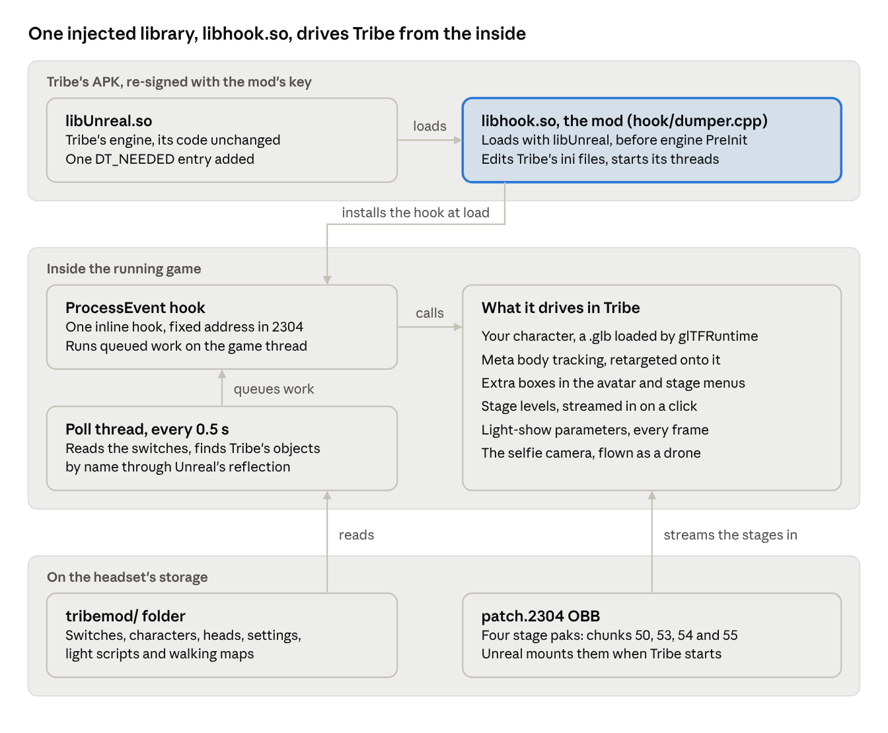
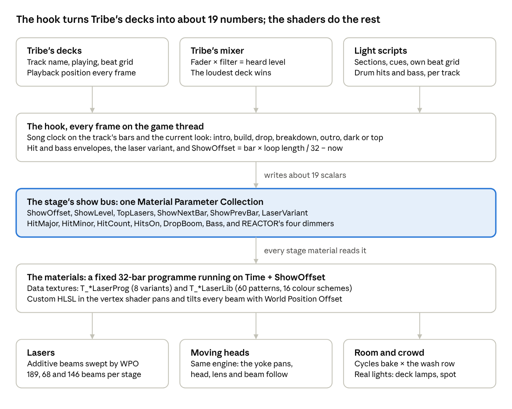

# Tribe XR Mod: Complete Guide

Oct 14, 2026 · exported from the shared guide document

## Start here

This mod adds custom characters, new stages, song-synced stage lighting and a drone camera to Tribe XR on Quest. It does this by injecting one native library, `libhook.so`, into Tribe 0.12.5.1 (versionCode 2304). Nothing in Tribe's source was changed; the library works on the shipped build from the outside.

Three things to know before you install it:

1. **It only runs on Tribe 0.12.5.1 (versionCode 2304).** The library finds Tribe's engine functions at addresses taken from that build's `libUnreal.so`. Every stage pak was also cooked against that build. Any other build is untested.
2. **It is signed with the modder's own key, not Tribe's.** The certificate is `CN=Tribe Mod` (SHA-256 `979d63d7…`). Android won't install it over a Store copy of Tribe, so the Store copy has to be uninstalled first. That deletes Tribe's data and OBB files on that headset.
3. **Meta's servers refuse the re-signed build's login.** Its `authenticate_application` call comes back "Unofficial Application", so it can't get a new token. Go Live and lounges work only while a token from a genuine Tribe login is still cached on the headset. Signing the mod with Tribe's own release key should avoid this. Only Tribe holds that key, so this guide couldn't test it.

The rest of this guide covers what the mod does, how it works, and how to install it. It then covers the settings, how to rebuild every part, and what we learned about Tribe and Meta along the way.

## What it does

The mod gives the player their own body, four extra stages, three of them with light shows that follow every song, and a flying stream camera. Everything happens on one headset: other players in a room see stock Tribe. "Verified" below means seen working in the headset on that date (2026); the APK shipped is the one verified last (installed Oct 11); the stages OBB also carries Graveyard Shift v7 and REACTOR v8, not yet looked at in the headset.

### Characters

| Feature | What the player gets | Switched on by | Status |
| --- | --- | --- | --- |
| Custom characters | You appear as your own rigged Blender `.glb`, loaded with glTFRuntime onto the mod's own skeletal mesh actor. Three ship: Lampwing, Skullbuck and the Headless Horseman. | `auto_load`, `auto_actor`, `skins/`, `active_skin.txt` | Verified Sep 30 |
| Character menu | One box per character, up to 8, in Tribe's avatar menu; a click loads it. `scripts/check_skin.py` checks a new `.glb` on the PC first. | `skin_menu` | Verified Oct 3 |
| Full-body tracking | Meta body tracking (84 joints) drives 22 bones. The head follows the headset and IK places the wrists. You see a headless copy; cameras see the full body. | `body_tracking` | Verified Sep 30 |
| Calibration | Stand still for about a second with straight arms. Every character is then fitted to your eye height. | automatic; `bt_recalibrate` redoes it | T-pose verified Sep 30. An A-pose that day was rejected by the T-pose detector; the A-pose path has never calibrated successfully |
| Hands | With hand tracking you see Tribe's hands. With controllers you see the character's hands, posed from Meta's hand joints, decided per hand. | automatic | Verified Sep 30; pickup fix Oct 5 |
| Selfie cam | The character appears in Tribe's selfie cam and stream. | automatic | Verified Sep 30 |
| Detachable head | Horseman only. About every 10 minutes of play the pumpkin flies off and circles for 15-25 s. If the selfie lens is within 12 m, it flies up to it ("boo"), then sits back down. | `heads/<skin>.glb`, `head.txt` | Verified Oct 10; play-time clock Oct 11; Horseman v3 not yet seen |

### Stages

| Feature | What the player gets | Switched on by | Status |
| --- | --- | --- | --- |
| Environment menu | Up to 4 extra boxes in Tribe's environment menu. A click switches to The Void, hides its screens and streams the stage in from the patch OBB. | `env_menu`, `envs.txt` | Verified Oct 5 |
| Dino Stage | A T. rex arch stage: arch-shaped screen, 4,446 animated dancers, a 189-beam laser rig and 19 moving heads, at about 72 fps. | box "Dino Stage" (chunk 50) | v14b live since Oct 10 |
| Giant intro | Dino only. A button behind the decks darkens the stage, lights a follow spot and lifts you 5.45 m in a floor-length robe. A second press lands you and restarts the show at the drop. | `giant.txt` | Verified Oct 6 |
| Dino Classic | The older animated version (v4) of the Dino Stage. | box "Dino Classic" (chunk 53) | Live |
| Graveyard Shift | A gothic facade with a portal screen, crypt doors and 146 lasers. v7 adds longer lasers, a darker deck and free roam. | box "Graveyard Shift" (chunk 54) | v7 live Oct 12, not yet visited |
| Stream intro ride | Graveyard only: a backstage crypt button, pressed three times. Press 1, the venue goes dark and the stream camera follows the Horseman riding through the woods. Press 2 sends him out. Press 3 is showtime: wide shot, the cued deck plays, the lights take the song. | `intro.halloween.txt`, `intro_deck.txt` | Presses 1-3 ran through to showtime on Oct 11, but the deck didn't play because intro\_deck.txt isn't written yet; not checked by eye |
| REACTOR | A 24 × 36 m reactor-hall club: airlock gate, soft crowd, moving heads, and lasers that land on surfaces. Dimmers for room, stage, crowd and rim. | box "Reactor" (chunk 55), `club.txt` | v8 live Oct 11 |
| Walking | Left stick walks where you look; right stick turns 30°; holding the right stick back for 1 s takes you back to the decks. Floors, steps, walls and a soft crowd come from the stage's walking map, and the legs swing in a walk cycle. | `<folder>_collide.txt`, `club.txt` | Walked on REACTOR Oct 9 and Graveyard Oct 10. The Dino map loads, but no walk there is recorded. |
| Big Dub | Three stages on real LiDAR terrain of the Big Dub festival site. | — | Planned; blockout Oct 10 |

### Show and stream

| Feature | What the player gets | Switched on by | Status |
| --- | --- | --- | --- |
| Lights that follow the music | Every track has its own light script with sections, cues and its own beat grid; 1,791 were generated from the modder's library. The lights follow whichever deck the crowd hears. See "Lights and lasers in depth". | `songs/`, `song.txt` | Song mode Oct 6; grid lock Oct 8; drum hits and bass Oct 9 |
| Visuals wall | The stage's screen becomes Tribe's backdrop, so videos from Tribe's Media tab fill it. The release has VJ loop packs: Dino (33 loops and a 60-minute set), Graveyard (9) and REACTOR (40 and a 60-minute set). | automatic with a stage | Verified Oct 6 |
| Drone camera | Flies the selfie-stick (stream) camera: an orbit from where you put the stick, or a shot reel per stage. Turning it off lands it back on the stick. | `drone_cam`, `drone.txt`, `drone_path*.txt` | Orbit verified Oct 3; reels in use Oct 10-11 |
| Go Live, Twitch, lounges | Tribe's own Go Live, lounges and multiplayer, with the custom character on. Works only while a token from a genuine login is fresh. | — | Verified Oct 2 with a real Twitch broadcast; last stream Oct 6 |

## How it works

The mod never changes Tribe's code. It adds one library that Android's loader pulls in along with Tribe's engine, and that library steers the running game through Unreal's own reflection.



`libUnreal.so` only gains an entry asking the loader for `libhook.so`. Everything the mod shows is read from the tribemod folder or streamed in from the patch OBB.

### Loading

- **One extra dependency.** `libUnreal.so` gets a new DT\_NEEDED entry for `libhook.so`. When Android loads Tribe's engine it loads the mod with it, and the mod's constructor runs before engine PreInit.
- **Before the engine starts.** The constructor creates the tribemod folder and edits Tribe's ini files: `bBodyTrackingEnabled` in Engine.ini, and the Ready Player Me keys in GameUserSettings.ini. It then finds `libUnreal.so`'s base address and starts two threads: the poll thread, and a small HTTP server on 127.0.0.1:8787 left over from the Ready Player Me route; it listens only if tribemod/custom.glb exists, and the starter ships none.
- **One hook, behind a switch.** Only if `tribemod/executor_on` exists does it hook `UObject::ProcessEvent`, at `base + 0x1858dd4`, an address taken from build 2304. It first checks that the address holds a function prologue and skips the hook if not. Deleting `executor_on` and relaunching leaves ProcessEvent unhooked; the ini edits and the two threads still run.

### Running

- **The poll thread** wakes every 0.5 s. It reads the switches and finds engine objects by walking `GUObjectArray` and the FName pool; `params.txt` caches their offsets.
- **Work runs on the game thread.** The poll thread never calls into the engine. It queues work, and the ProcessEvent hook runs it on the game thread: it builds each call's parameter buffer by reflection, looking up property offsets by name, and calls Tribe's and Unreal's own UFunctions through the original ProcessEvent.
- **Per-frame work** runs in the tick of the mod's own avatar actor, a skeletal mesh actor it spawns. That covers the body-tracking retarget, walking, the detachable head, the drone and the light show's parameters.

### Content

- **Characters** are `.glb` files loaded at runtime with glTFRuntime, which Tribe already ships for its Ready Player Me avatars. Nothing is cooked for them.
- **Stages** are ordinary Unreal levels, cooked with Tribe's exact engine into pak chunks and packed into a patch OBB that Unreal mounts at launch. Clicking a stage's box switches Tribe to The Void for its lighting rig and hides the Void's screens. The mod then streams the level in with `LoadLevelInstanceBySoftObjectPtr`. Picking a stock environment unloads it.
- **Lights and lasers** are materials inside those levels. The mod writes their parameters every frame from the deck state, as the next section explains.

### Tied to build 2304

The ProcessEvent address, the offsets in `params.txt`, the struct offsets hard-coded in dumper.cpp, the OBB file names and the cooked paks all belong to build 2304. The mod doesn't check Tribe's version. On another build, the prologue check skips the hook unless that address happens to start some other function.

## Lights and lasers in depth

Apart from two deck lamps per stage and the Dino Stage's follow spot, the stages add no Unreal lights, and Tribe's Void rig stays on underneath. Every laser, moving head and wash is unlit geometry whose motion and colour are computed in its own material. The hook drives all of it by writing 19 shared scalars, plus a few stage extras, into one Material Parameter Collection per stage, every frame, from Tribe's own decks and mixer.



The hook does everything above the show bus once per frame, on the CPU; everything below it runs in the shaders. A stage author needs the bus's names and its clock: Time + ShowOffset over one 32-bar loop of 54.86 s. Today a new stage also needs its folder added to the hook's table of show buses (dumper.cpp:2539), so a hook rebuild.

### From the decks to the show

1. **Which deck the crowd hears.** Every 0.25 s the hook reads each deck's track file name, whether it's playing, and Tribe's beat grid (`BeatgridBpm`, `BeatgridStartMs`). Every frame it reads the playing deck's `GetPlaybackSeconds`, so pitch changes, sync and cue jumps stay locked.
2. **Heard level.** A deck's heard level is its channel fader (`CurrentSliderOffset`, -2.2 to +2.2) times its filter's openness. The filter counts as fully open up to 55% of the knob's travel and silent by 95%. The loudest deck drives the lights, and it only hands over when another deck is 0.15 louder or it drops under 0.1. If the mixer can't be read, the deck that has played longest wins. The crossfader, headphone cue and EQ aren't read; a cued track stays out of the lights because its fader is down.
3. **Song mode or the free show.** If the loud deck's track has a light script, its sections drive the show on the track's own bars. Without one, the show locks to Tribe's beat grid for that deck and fakes hits on the beats: 1 and 3 major, 2 and 4 minor. A script without a grid= line runs its looks at its own bpm=. With no script and no grid, the hook stops writing ShowOffset and the material's own 140 BPM loop carries on.
4. **The bar clock.** Bars are counted on the script's own beat grid first and Tribe's grid second, with the first drop on beat 1. Cues snap to the nearest beat within 0.15 s.
5. **The show bus.** Each frame the hook writes the stage's collection (`MPC_DinoGiant`, `MPC_ClubShow` or `MPC_HwShow`) through `KismetMaterialLibrary.SetScalarParameterValue`. ShowOffset is written every frame; the hit, boom and bass envelopes skip changes under 0.004; the rest are written when they change or while they fade.
6. **The trick that makes any tempo work.** The materials run a fixed 32-bar loop at a nominal 140 BPM, on `Time + ShowOffset`. The hook writes `ShowOffset = bar × loop length / 32 − now` every frame, which lands that loop on the track's real bars at whatever tempo is playing.

### The parameters

| Parameter | What it does | Set from |
| --- | --- | --- |
| `ShowOffset` | Puts the material's 32-bar loop on the track's current bar | The bar clock and the current look |
| `ShowLevel` | Master level of the show; 0 is a blackout | The look; in song mode it fades 0.15 s up and 0.3 s down, otherwise 0.3 s up and 1.5 s down |
| `TopLasers` | Lights only the top laser groups (on the Dino: horns, towers and mouth) | The "top" look |
| `ShowNextBar`, `ShowPrevBar` | The bar that really comes next or before when a section loops, so the end-of-bar blend aims at the right bar | The look |
| `LaserVariant` | Which of 8 laser programmes runs | FNV-1a of the script's `match=`, mod 8 (32-bit, unlike the 64-bit file keys); in the free show it steps every 32 bars |
| `HitMajor`, `HitMinor`, `HitCount`, `HitsOn` | Flashes, fan bursts and tilt pops on drum hits, and a hue step per major hit | The track's `.hits` file: HitMajor is 0.4 + 0.6 × intensity and HitMinor 0.3 + 0.7 × intensity, decaying with a 0.15 s time constant; the free show uses 0.8 on beats 1 and 3 and 0.6 on 2 and 4 |
| `DropBoom` | Opens every fan and washes the beams 60% white | Each drop or top start, falling over 1.2 s |
| `Bass` | Opens the fans and keeps the lasers lit with the low end | The `.bass` envelope, 30 ms attack and 150 ms release time constants; song mode only |
| `RoomGain`, `StageGain`, `CrowdGain`, `CrowdRim` | REACTOR's four dimmers | `club.txt`, 0 to 4 |
| `SpotOn`, `DoorOpen`, `IntroStep`, `PlayerX`, `PlayerY` | The Dino follow spot; Graveyard's crypt door and intro steps; the head's position, so the crowd makes way (written only while walking runs) | The giant lift, the stream intro, the walking code |

The 19 shared names (`dumper.cpp:2521-2523`) are the twelve in the table's first eight rows, SpotOn, and six for the Dino Stage's giant lift and robe: `Height`, `RobeTopX`, `RobeTopY`, `RobeTopZ`, `RobeOn` and `ButtonGlow`. The table's other names are stage extras, written by the club, intro and walking code. `MPC_ClubShow` also defines `GateOpen`, `GateState` and `GateDeny`, which nothing writes yet.

### Light scripts

Each track has up to three files in `tribemod/songs/`, named by the FNV-1a 64 hash of the deck's track file name, ASCII lower-cased, as 16 hex digits: `<key>.txt`, `<key>.hits` and `<key>.bass`. A script loads when the track changes and is used only if its `match=` text appears in the track name, so a renamed file loses its script. Non-ASCII characters become ? before hashing. The match= text is case-insensitive and must not be followed by a letter or digit, so PRELUDE I doesn't match PRELUDE II.

```text
match=<file name>.mp3
bpm=142
grid=142 27.0823
cues=0:intro 16.7:build 27:drop 79.8:breakdown 109.08:build 122.6:drop 187.95:show
```

- **`grid=`** is the track's own beat grid: its BPM and the time of the first drop's beat, in seconds.
- **`cues=`** is up to 48 `seconds:look` pairs. A look loops one part of the 32-bar programme in step with the song: intro = bars 0-7, build = 8-14, drop = 16-23, breakdown = 24-27 and outro = 28-31. `dark` is a blackout, `top` shows only the top lasers on the drop's patterns, and `show` returns to the free-running programme.
- **`lift=a b c`** drives the Dino Stage's giant lift. The set's opener has a hand-tuned script that uses it.
- **`.hits`** holds one little-endian uint32 per drum hit: `(ms << 8) | (major << 7) | intensity`. **`.bass`** holds one byte per 100 ms.

**Why the mod brings its own beat grids.** Of 19 tracks checked on Oct 8, Tribe's grid had the wrong tempo on 6, for example 142.38 BPM for a 140 BPM track. On 7 more, the first beat was 40-70 ms early.

**How the scripts are made.** `scan_library.py` measured 2,051 tracks on the headset, and `make_cues.py` turned them into 1,791 scripts:

- **Sections.** A frame counts as drop when, by a 5 s majority vote, the loudness is within 4 dB of its 97th percentile and the sub-bass within 8 dB of its own. Silences become gaps. Sections under 6 s merge into their longer neighbour, and long ones split where the level moves more than 6 dB. Each section start moves onto the steepest rise that stays up for 1 s.
- **Builds and breaths.** A breath of 0.4 s or more before a drop becomes `dark`. The build is the section before a drop if it began within 16 bars of it, otherwise the 8 bars before the drop.
- **Grid.** A comb fit over the onset envelope, written only when its confidence is at least 1.7. 1,743 of the 1,791 scripts carry one.
- **Hits.** Onset peaks on 16th notes at 0.65 of the bar's maximum or more (0.85 or more is major), at most one per beat, none in quiet bars.
- **Bass.** Sub and low energy, normalised between the 15th and 99th percentiles and raised to the power 1.3.

### The laser engine

- **One shared engine.** All three stages use it; it is written once in `dino_materials.py`, and the club and Graveyard import it.
- **Beam geometry.** Each beam is an additive, two-sided pair of crossed quads, 2 cm wide at the aperture and widening to 10 cm. UV channels 1-5 carry the beam's pivot, phase, pan and tilt amplitudes, group, place in the fan, side, and a beam-or-aperture flag.
- **Two data textures.** Two Custom HLSL vertex nodes, `LaserMotion` and `LaserColor`, read `T_*LaserProg` and `T_*LaserLib`. LaserProg is 32 bars × 8 variants: the pattern, colour, level and which groups may fire. LaserLib is 64 rows × 11 texels: 60 motion patterns and 16 colour schemes. Patterns change every 2 bars and colours every 4, each blending over the last 15% of the bar.
- **Motion.** World Position Offset pans each beam about world Z through its pivot, then tilts it about its own horizontal axis. Colour and alpha reach the pixel shader through a VertexInterpolator, so the pixel shader only multiplies.
- **Moving heads** run on the same engine. The yoke pans; head, lens and beam move rigidly; at most 2 cycles per bar.
- **The cue table.** Every fixture, lasers included, reads a cue table, `T_*Cues`: 32 bars × 16 rows, with level, strobe and beat pulse in R, G and B. Each mesh reads its own row. A laser's brightness is its group's cue level × beat pulse × ShowLevel, times the pattern's visibility, the hits and the bass, with a ±7.5% shimmer at 9 Hz.
- **The room light** is a Cycles bake, scaled by the cue table's wash row from a floor of 0.05-0.08 upward; on the Dino Stage it peaks at 60% of the bake (NIGHT\_GAIN 0.6), and REACTOR adds its dimmers. The only real Unreal lights are two 3 cd deck lamps per stage, for Tribe's lit deck gear, and the Dino Stage's follow spot.
- **Comfort rules.** There are no strobes (`show.py` forces strobe to 0), at most one hit per beat, and a beam switched on or off at most 1.24 times a second when measured on v9, before hits, bass and scene masks were added; every laser also carries a ±7.5% shimmer at 9 Hz.
- **Wiring.** Unreal 5.4's Python can't wire World Position Offset, so the editor plugin `ModMaterialTools` does it.

### Fixtures per stage

| Stage | Lasers | Moving heads | Also |
| --- | --- | --- | --- |
| Dino Stage (v14b) | 189 beams from 24 units: a centre fan, 8 horn-tip units, 4 tower units, 6 stage-front units, a ring under the T. rex's chin and 4 delay towers, up to 58-70 m long | 19 | 4 xenon units with 6 heads and 340 m beams (static, opacity only), the follow spot, LED pillars and bulb chases |
| REACTOR (v8) | 68 beams from 8 units: 4 front-truss fans, 2 mezzanine poles and 2 back-truss units aimed at the floor; every beam lands on a surface | 38: 24 in the hall, 8 over the core bay, 6 on the floor | Pixel strips, the reactor core breathing with the bass, and the four dimmers, which are written only while its walking map is loaded |
| Graveyard Shift (v7) | 146 beams from 17 units: a portal fan, 4 gargoyle mouths, 2 sky lasers 120 m long, 6 deck-edge posts and 4 skulls on crypt towers | 26 fixed heads (opacity only) and 4 searchlights | Glowing windows, eyes, lanterns and the crypt doorway; 3 fog sheets; a 32-row cue table |

### What went wrong, and the fixes

- **The FBX V flip froze every laser until Dino v12.** Unreal's FBX import stores 1-v on every UV channel. So every beam read as an aperture: no motion, lit at 35% or more, "all on at the same time". The fix reads every data V as 1-v and imports with full-precision UVs; FP16 had moved 65 m pivots by about 6 cm.
- **The bass never arrived until build song13.** The hook read only the first 16 parameters of a collection, and `Bass` was the 17th. The cap is now 64.
- **Too many lasers at once.** All groups were lit in 92% of bars. Per-bar group masks brought that to 11%.
- **Beams hanging in mid-air.** REACTOR v8 and Graveyard v7 make every beam reach a surface in all of its poses (on REACTOR that puts beams through eye height, 1.2-1.9 m, over 87% of the crowd floor in at least one pose; the near-eye fade is the only guard and is untested in the headset), with width and fade set per metre and a fade within 80 cm of the eye.
- **Open risks, not checked in the headset.** When a section loops, a pattern with a non-whole number of cycles in it can snap at the seam. REACTOR's core holds at 0.7 in the free show. Graveyard's bats, ghosts and coffin lids may decode V wrong.

### Performance, and what has been seen

- **Frame rate.** Dino v9 held 71.9-72.0 fps at 72 Hz through both drops, worst frame 17-25 ms. On v8, one 46 s stretch ran at about 58 fps after a 400 ms hitch, when Go Live started or friends joined; the notes don't say which. After the post-boot warm-up, all three stages held 72 fps (Oct 9). REACTOR v7 averaged about 71 fps on Oct 10 (device log; the minimum depends on whether load hitches count); REACTOR v8 and Dino v14b haven't been measured. Graveyard v6 averaged 69.5 fps in song mode with the stream camera on (minimum 60.7, Oct 11), below the 71 fps target; the cause isn't isolated.
- **Overdraw.** Translucent overdraw from the DJ's position was 0.57 layers per pixel on the Dino Stage, measured before the 189 lasers went in, and 1.82 on Graveyard v7 counting everything, 1.07 behind the set. The budget is 2.5.
- **Seen in the headset.** On Oct 9 the log confirmed hits, bass and variants per song on the Dino Stage (v13, the first build with the V-flip fix and the moving heads), and the modder asked for it darker, which became v14. No note records anyone watching the lasers or heads move since the V-flip fix. On Oct 10 in REACTOR, the log shows the lights handing over from deck 2 to deck 1 as deck 2's fader came down, with the laser variant changing too. On Oct 11, Graveyard v6's show followed the music: all 19 parameters found, variant changes, drop booms and bass. REACTOR v8 and Graveyard v7 haven't been looked at yet.

### What Tribe could add to make this official

- **Per-deck state:** an "on-air" level that includes the crossfader, cue and EQ; the bar and beat phase; and a stable track ID instead of the file name.
- **Better analysis:** more reliable beat grids, and section, hit and bass analysis alongside Tribe's BPM analysis. A fix for Tribe's mis-gridded tracks through the player's `SetBeatGrid` was proposed during the project but not built.
- **A show-bus contract:** the 19 shared names plus a naming convention for stage extras, published for environment authors and replicated, so everyone in a room sees the same show.
- **The engine as a material function library** that environment authors can drop in.

## Installing on a Quest

Download the release into one folder, plug the headset in, and run `scripts/install_tribemod.sh <folder>`. The one real decision is which key the APK is signed with, because that decides whether Meta's login works.

### What's in the release

| File | Size | What it is |
| --- | --- | --- |
| `tribemod-2304-combo3.apk` | 112 MB | The mod: Tribe 2304 with `libhook.so` injected, signed `CN=Tribe Mod` (md5 `a156adfc`) |
| `main.2304.com.TribeXR.TribeXR.obb` | 2.03 GB | Tribe's own game data for build 2304, unchanged |
| `patch.2304.com.TribeXR.TribeXR.obb` | 469 MB | The four stages: pak chunks 50, 53, 54 and 55 (md5 `cae836af`) |
| `tribemod-starter.zip` | 23 MB | The settings folder: three characters, the Horseman's head, walking maps, drone reels, the Graveyard intro, 1,791 light scripts and the settings files |
| `install_tribemod.sh` | 9 KB | The installer, also in `scripts/` |
| `dino-visuals-loops.zip`, `reactor-visuals-loops.zip`, `graveyard-visuals-loops.zip` | 436 MB, 1.05 GB, 231 MB | VJ loops for the visuals wall: 33, 40 and 9 videos |
| `dino-visuals-full-set.mp4.part1` and `.part2`, `reactor-visuals-full-set.mp4.part1` and `.part2` | 2.7 GB per set | The two 60-minute sets, split to fit GitHub's 2 GiB file limit |
| `stage-sources.zip` | 411 MB | Three stage projects and a crowd-test project: Unreal content, config and plugins |
| `SHA256SUMS.txt` | 1 KB | Checksums of every file, and of the two sets once rejoined |

### Choose the signing key

**Route A: sign it with Tribe's release key (recommended).** Only you can do this.

```bash
zipalign -f -p 4 tribemod-2304-combo3.apk aligned.apk
apksigner sign --ks <Tribe's release keystore> --out tribemod-2304-tribe-signed.apk aligned.apk
scripts/install_tribemod.sh --apk tribemod-2304-tribe-signed.apk <folder>
```

The new signature replaces the mod's. On a headset with Tribe 2304 from the Store, the installer then updates in place and keeps the login, data and OBBs. With a newer Tribe it has to uninstall first. Meta's login should work, because a genuine-signed build logs in even when sideloaded. That is untested: if Meta also checks the APK's contents, this route fails the same way as route B.

**Route B: install it as built.** Android won't update a Store-signed Tribe with a differently signed APK, so the installer asks, uninstalls Tribe (deleting its data and OBBs) and pushes both OBBs back. The re-signed build can't log in to Meta, so Go Live and lounges won't work this way, and a headset that has never logged in to Tribe probably stays at sign-up. The characters, stages and lights are all local; only the character has been seen working without a valid login. Route A avoids all of this.

### Install

1. Turn on Developer Mode for the headset in the Meta Horizon phone app. Connect it by USB and allow USB debugging ("Always allow").
2. Download every release file into one folder; the APK, both OBBs and the starter zip are required, the rest is optional. Check them with `sha256sum -c --ignore-missing SHA256SUMS.txt`.
3. Run `scripts/install_tribemod.sh <folder>`. Add `--apk <file>` for route A, `--media <folder>` once per unzipped loop pack, and `--serial <id>` if several headsets are connected. Options go before the folder, and folder names with spaces need quotes, such as "Dino Visuals". --yes skips the uninstall question, and ADB=\<path> picks which adb to use. It installs the APK, pushes any OBB that is missing or different, copies the starter files into `tribemod/`, creates the switches and grants the storage permissions. It has been tested against a simulated adb (tests/install\_tribemod\_test.sh), not yet on a real headset.
4. In the headset, launch Tribe. On Meta's unofficial-app dialog, tap **OPEN APP**. If the dialog offers only Restore and Close, tap Close and launch Tribe again. Never tap Restore: it deletes the mod and both OBBs and installs the Store build.
5. Tribe may restart itself once; that's normal. Put the headset on, because the mod waits for VR focus. Stand still with straight arms for a second: that one pose calibrates every character to you.
6. Check it worked:
   - your character appears in the selfie cam;
   - the avatar menu shows a box per character;
   - the Dino Stage loads by itself, and the environment menu lists Dino Stage, Dino Classic, Reactor and Graveyard Shift.
7. If the character doesn't appear on the first launch after an install, relaunch Tribe once. `adb logcat -s TRIBEMOD` shows the mod's log: `ProcessEvent hook installed`, then `[LOAD]` and `[ENV]` lines.

### Videos for the visuals wall

Unzip each loop pack and pass its folder to the installer with `--media`. The videos land in `/sdcard/Movies/<folder>/` and show up in Tribe's Media tab. To use a 60-minute set, rejoin it into the unzipped pack folder before running the installer, and check it against `SHA256SUMS.txt`:

- macOS, Linux or Git Bash: `cat dino-visuals-full-set.mp4.part1 dino-visuals-full-set.mp4.part2 > "Dino Visuals - Full Set.mp4"`
- Windows Command Prompt: `copy /b dino-visuals-full-set.mp4.part1 + dino-visuals-full-set.mp4.part2 "Dino Visuals - Full Set.mp4"`

### Updating and removing

- **Update:** `adb install -r <new APK>`, signed with the same key. It keeps data, OBBs, permissions and the login token. Re-run the installer to refresh the starter files; that resets the settings files to the starter's copies but keeps your calibration.
- **Remove:** `adb uninstall com.TribeXR.TribeXR`, then install Tribe from the Store again.

## Settings

Everything the mod does is switched and tuned by files in one folder on the headset: `/sdcard/Android/data/com.TribeXR.TribeXR/files/tribemod/`. A flag is an empty file that switches something on by existing. A one-shot is a flag the mod acts on once. The mod's poll thread checks the folder every 0.5 s; files marked "launch" are read once, when the library loads. Line numbers are in `hook/dumper.cpp` unless another file is named.

The avatar has to load before anything else runs: every per-frame feature, stages included, runs in the tick of the mod's own avatar actor. So `executor_on`, `auto_load`, `auto_actor` and one character are the minimum for every feature.

### Core switches

| File | Kind | Values (default) | What it does | Source |
| --- | --- | --- | --- | --- |
| `executor_on` | flag, launch | — | Installs the ProcessEvent hook. Without it ProcessEvent stays unhooked, though the ini edits, the poll thread and the local HTTP server still run. | 3848-3855 |
| `auto_load` | flag | — | Finds the engine objects and loads the character, once per launch. `load_avatar` is the one-shot version. | 910-913, 3771-3779 |
| `auto_actor` | flag | — | Spawns the mod's own avatar actor, whose tick drives every per-frame feature. `iso_here` is the one-shot version. | 3780-3785, 3217-3220 |
| `params.txt` | text | `np= ga= bo=` (absent: scan) | Cached engine offsets for build 2304, so the object scans can be skipped. | 185-196, 911-913 |

### Characters and body tracking

| File | Kind | Values (default) | What it does | Source |
| --- | --- | --- | --- | --- |
| `skins/*.glb` | data | glTF binary; mesh 0 skinned, Ready Player Me or Mixamo bone names | The characters. Up to 8 boxes in Tribe's avatar menu, each labelled with its file name. | 2075, 3464-3475 |
| `active_skin.txt` | text | a file name in `skins/` (absent: `glb_path.txt`, then `custom.glb`) | Which character loads. Clicking a box rewrites it. | 1211-1214, 2134-2139 |
| `skin_menu` | flag | — | Adds the `skins/` boxes to Tribe's avatar menu. | 3502-3521 |
| `custom.glb` | data | glTF binary | Last-resort character. Also served on 127.0.0.1:8787 for the old Ready Player Me route. | 760-858 |
| `body_tracking` | flag | — | Turns on Meta body tracking (`bBodyTrackingEnabled=True` in Engine.ini, written at launch) and retargets it onto the character. | 733-748, 3786-3797 |
| `bt_user_calib.txt` | written by the mod | — | The wearer's calibration, captured from one still T- or A-pose and used for every character. Personal: don't copy it between people. | 1476-1499, 1589-1595 |
| `bt_recalibrate`, `bt_calibrate_now`, `next_skin` | one-shot | — | Redo the calibration, capture it now, or switch to the next character. | 3791-3795 |
| `avatar_url.txt`, `avatar_etag.txt` | text, launch | a URL | The old route: writes Tribe's `ReadyPlayerMeAvatarUrl` and `ReadyPlayerMeETag`. When absent, the mod deletes those two keys from GameUserSettings.ini. | 670-756 |
| `bt_nosplit` | flag | — | Debug: one mesh, visible to everyone. | 3733 |
| `a2_inflight` | written by the mod | — | Crash guard: if it is still there at launch, the retarget stays off for that launch. | 1625-1627, 3734 |

### Detachable head

| File | Kind | Values (default) | What it does | Source |
| --- | --- | --- | --- | --- |
| `heads/<skin>.glb` | data | static mesh; the character needs `DH_C`, `DH_F` and `DH_U` bones | The head that flies off that character. Needs body tracking. | head.cpp:1-11, 95-101 |
| `head.txt` | text | `auto`, `on`, `off` or `boo`; `every=600` (seconds of play); `boomax=12` (m); `intro=hold` or `free`; `fwd=+y up=+z` (absent: `auto`) | When and how the head flies. | head.cpp:252-268 |

### Stages and walking

| File | Kind | Values (default) | What it does | Source |
| --- | --- | --- | --- | --- |
| `env_menu` | flag | — | Adds the stage boxes to Tribe's environment menu and starts the walking, light, giant and intro lookups. | 3631-3642 |
| `envs.txt` | text | `Label=/Game/Mods/<Folder>/Maps/<Level>`, up to 4 lines, `#` comments (absent: one "Festival" box) | Which stages appear. The release lists Dino Stage, Dino Classic, Reactor and Graveyard Shift. | 2166, 3538-3550 |
| `active_env.txt` | written by the mod | a box label | The last stage picked, re-applied after launch. | 2373-2375, 3695-3700 |
| `<folder>_collide.txt` | text | `rules`, `floor`, `box`, `gate`, `circle`, `person` and `spot` lines, up to 512 KB; one bad line rejects the whole map | The walking map for that stage (absent: no walking). | club.cpp:12-14, 103-128; club\_collide.h:53-74 |
| `club.txt` | text, read every 2 s | `walk=1 speed=180 deadzone=0.25 turn=30 role=auto` (or `host`, `dj`, `guest`); `room= stage= crowd= rim=` from 0 to 4 | Walking settings, and the club's dimmers. | club.cpp:28-35, 85-102 |
| `giant.txt` | text | `height=545 rise=8 descend=60 press=14` | The Dino Stage lift. The starter's giant.txt sets rise=44. | 2510, 2571-2577 |
| `env_autotest` | one-shot | — | Loads the first box without a click, for testing. | 3701-3704 |

### Lights

The section "Lights and lasers in depth" explains these.

| File | Kind | Values (default) | What it does | Source |
| --- | --- | --- | --- | --- |
| `songs/<key>.txt`, `.hits`, `.bass` | data | key = FNV-1a-64 hex of the lower-cased track name | The generated light script for each track. | 2655-2658, 2770-2900 |
| `song.txt` | text, read every 5 s | `match=`, `bpm=140`, `lift=`, `grid=`, `cues=t:look` | A hand-written light script for one named song. | 2617-2685 |
| `lights.txt` | text | `<name part>=<multiplier 0-20>`, up to 8 lines | Scales Tribe's own lights while a mod stage is up. | 2342-2367 |
| `hits.txt`, `mix.txt` | text | `offset_ms=0` (±500); `fader_sign=-1` | Shift the hits in time; flip the fader direction. | 2674-2678, 2783-2786 |

### Drone camera and stream intro

| File | Kind | Values (default) | What it does | Source |
| --- | --- | --- | --- | --- |
| `drone_cam` | flag | — | Flies Tribe's selfie and stream camera along a shot reel. | 3428-3454 |
| `drone.txt` | text | `target=selfie` (or `auto`), `mode=orbit` (or `path`), `radius=300 height=80 speed=12 look=-40 bob=20` | Drone settings. In orbit mode, radius and height default to where you hold the stick; the starter's drone.txt is just mode=path. | 1904, 3396-3410 |
| `drone_path[.<folder>].txt` | text | `fly` and `orbit` lines, up to 40 shots | The shot reel: the stage's own file first, then `drone_path.txt`, then the built-in reel. | 1916-1956 |
| `intro.<folder>.txt` | text | `key`, `loop`, `exit`, `cam`, `wide`, `button`, `fov`, `rider`, `woods`, `door`, `hold` and `back` lines | The stage's stream intro, such as Graveyard Shift's horse ride. | intro.cpp:95-113; intro\_ride.h:31-64 |
| `intro_deck.txt` | text | `play` or `stop deck:<Fn>`, or `button:<Fn>` (the full form is play deck:\<Fn> or stop deck:\<Fn>, optionally with param=value; button:\<Fn> presses the Play button instead; absent: decks untouched) | Lets the intro press Play on a deck. | intro.cpp:29-34, 66-94 |

### Diagnostics and logs

| File | Kind | What it does | Source |
| --- | --- | --- | --- |
| `dump_now`, `log_pe`, `log_deck`, `skin_trace`, `probe_on`, `capture_probe` + `capture_now`, `fbo_probe`, `cam_probe`, `http_log` | flags | Object dumps, ProcessEvent logs and probe captures. `http_log` also raises Tribe's HTTP log level in Engine.ini. | 396-666, 749-755, 3243-3358, 3766-3812 |
| `ini_upsert.log`, `httpd.log`, `load_result.txt`, `bt_joints.txt` | written by the mod | What happened at launch, the HTTP server, the character load and the tracked joints. | 676, 765, 906, 1361 |

### Outside the folder

- **Tribe's own ini files.** `GameUserSettings.ini` and `Engine.ini` under `/data/data/com.TribeXR.TribeXR/files/UnrealGame/TribeXR/TribeXR/Saved/Config/Android/`. The mod edits them atomically when the library loads, before engine PreInit (674-756).
- **The OBBs** in `/sdcard/Android/obb/com.TribeXR.TribeXR/`. `main.2304.com.TribeXR.TribeXR.obb` is Tribe's own data. `patch.2304.com.TribeXR.TribeXR.obb` is a stored zip of `TribeXR/Content/Paks/*.pak` holding the four stages: chunk 50 Dino Stage, 53 Dino Classic, 54 Graveyard Shift and 55 Reactor. Unreal mounts both at launch.
- **Videos** for the media wall go in `/sdcard/Movies/<folder>/`. The 360 videos Tribe found were in /sdcard/Download/ instead. Tribe reads both itself; the mod doesn't touch them.

## Building it yourself

Four things get built, separately: the hook library, the stage paks, the characters and the light scripts. The hook takes a minute. A stage takes a Blender bake plus an Unreal cook in Meta's fork of UE 5.4.4. The repo's hook sources are byte-identical to the shipped build's (combo3, checked by md5).

### The hook library

1. Compile with Android NDK r26d. `dumper.cpp` pulls in the other hook files itself:

```bash
aarch64-linux-android32-clang++ -shared -fPIC -O2 -fvisibility=hidden -nostdlib++ \
  -Wl,--no-undefined -Wall -Wformat=2 -o libhook.so \
  hook/dumper.cpp hook/vendor/And64InlineHook.cpp -llog -lm
```

`-nostdlib++` is needed because Tribe ships no `libc++_shared.so`; the library then depends only on liblog, libm, libdl and libc. The shipped build has no errors and seven known warnings: 386,848 bytes, md5 `8a5b3209`.

2. Patch Tribe's 2304 APK, once. Only three entries change, and one is added; the other 746 are byte-identical:
   - `lib/arm64-v8a/libUnreal.so`: `python hook/add_needed.py libUnreal.so libUnreal.patched.so` adds `libhook.so` to its DT\_NEEDED list. This is a metadata edit, and the entry point doesn't move.
   - `AndroidManifest.xml`: `scripts/patch_manifest.py` clones Tribe's face-tracking entries into `com.oculus.permission.BODY_TRACKING` and the feature `com.oculus.software.body_tracking`. Usage: `patch_manifest.py IN OUT tag:TEMPLATE_NAME:NEW_NAME ...`.
   - `lib/arm64-v8a/libhook.so`: added.
   - The signature files are replaced when you sign.
3. For each new hook build, replace `lib/arm64-v8a/libhook.so` in the patched APK (the modder uses `7z a`), then align and sign: `zipalign -f -p 4`, then `apksigner sign`. `scripts/sign_apk.sh` does both with the modder's key; use your own.
4. Update the headset with `adb install -r`, which keeps data, OBBs and permissions. Every build on one headset must be signed with the same key, or the in-place update is refused.

**Tests** run on a PC with any C++ compiler: `tests/club_collide_test.cpp` (the walking rules as a 10 cm flood fill; it also builds for the headset), `tests/gait_test.cpp` and `tests/intro_ride_test.cpp`. Each file's header has its build line; for MSVC it is `cl /O2 /EHsc tests\<name>.cpp`.

### A stage

Every stage is generated by scripts, not built by hand. Each lives in its own copy of the Unreal project. The scripts are in `stages/`, and the projects are in `stage-sources.zip` in the release.

1. **Blender 4.5, headless.** `blender -b --factory-startup --python stages/scripts/Blender/dino_stage.py` builds the geometry, bakes all lighting with Cycles and writes one FBX per material plus PNG textures. `show.py` writes the light show's data textures.
2. **Import, in Meta's fork editor.** `UnrealEditor.exe TribeXR.uproject -ExecutePythonScript=build_dino.py -unattended -nosplash` imports the meshes and builds the materials. Static surfaces are instances of materials Tribe already ships; the animated ones compile to new shaders that travel in the chunk's shader archive. It then places the actors with collision off and labels the content into the stage's chunk.
3. **Cook with the same fork.** `UnrealEditor-Cmd.exe TribeXR.uproject -run=cook -targetplatform=Android_ASTC -unversioned` -map=/Game/Mods/\<Folder>/Maps/\<Level> -unattended -nosplash -nullrhi. From Git Bash, set `MSYS_NO_PATHCONV=1` or the cook silently skips the map.
4. **Pack.** `pack_chunk.sh <chunk>` repaks the files in the cook's chunk manifest, plus the chunk's shader library, into `pakchunk<NN>-Android_ASTC_P.pak`. It uses pak version 11 and mount point `../../../`, like Tribe's own paks. `make_obb.py` then wraps every live pak in a stored zip with the comment `"      2304"`, as `patch.2304.com.TribeXR.TribeXR.obb`.
5. **Ship.** Push the OBB to `/sdcard/Android/obb/com.TribeXR.TribeXR/` and add `Label=/Game/Mods/<Folder>/Maps/<Level>` to `envs.txt`. The modder's `scripts/push_obb.sh` merges one pak into the OBB already on the headset, so a push never drops another stage.

The chunks in use are 50 (Dino Stage), 53 (Dino Classic), 54 (Graveyard Shift) and 55 (REACTOR); Big Dub has 56 reserved. Before trusting a new engine build, `stages/projects/verify_fork.sh` compares its reflection data with Tribe's `libUnreal.so` and cooks an engine material for a byte-for-byte match with Tribe's own copy.

### A character

- The contract is `claudedocs/avatar_blender_spec.md`. In short: a glTF binary whose mesh 0 is skinned, in metres with applied scale, using Ready Player Me or Mixamo bone names. A `mixamorig:` prefix is fine.
- `scripts/check_skin.py <file.glb>` reports whether it will load and move with you, and can push it to the headset.
- A detachable head also needs `DH_C`, `DH_F` and `DH_U` bones, plus the head itself as `heads/<skin>.glb`. `scripts/horseman_build.py` shows how the Horseman was made from Skullbuck.

### Light scripts for another music library

1. `stages/scripts/songs/scan_library.py` pulls every audio file under `/sdcard/Music` on the headset into a temporary folder and measures it. Edit its hard-coded adb path, headset serial and Songs folder first. It records energy in five bands every 0.1 s, onset strength, and beat times found with librosa, at a prior tempo of 140 BPM. It keeps only these features and deletes the audio.
2. `make_cues.py` writes one light script per track, with intro, build, dark gap, drop, breakdown and outro sections. Each cue lands on a measured hit, not a guessed grid. A hand-tuned script in `Songs/overrides/<file name>.txt` replaces the generated one.
3. Copy the results to `tribemod/songs/` on the headset. Each file is named by the FNV-1a 64 hash of the lower-cased track file name, which is how the mod finds it.

### VJ loops

`stages/visuals/` holds the generators of all three packs (dino/, reactor/, graveyard/): one Blender 4.5 (EEVEE) script per loop, on a shared kit such as the Dino pack's `vjkit.py`: a 140 BPM half-time grid, 8-bar seamless loops, 1080p30 H.264. `assemble_set.py` cuts the 60-minute sets. `CONCEPTS.md` has the full spec.

## Where everything is

The repo holds the mod's source, a snapshot of the stage generators, the tooling and the lab notebook. The binaries and the Unreal projects are in the GitHub release instead, and the signing key stays with the modder.

### In the repo

| Path | What's there |
| --- | --- |
| `hook/dumper.cpp` | The mod, built as one translation unit. It `#include`s `club.cpp` (walking and the REACTOR dimmers), `head.cpp` (the detachable head), `intro.cpp` (the stream intro) and `gait.h` (the leg cycle). |
| `hook/club_collide.h`, `hook/intro_ride.h` | The walking-map rules and the intro ride's path, shared with the tests |
| `hook/vendor/` | And64InlineHook (MIT), the inline hook used on ProcessEvent |
| `hook/add_needed.py` | Adds `libhook.so` to `libUnreal.so`'s DT\_NEEDED list, with LIEF |
| `hook/hook.cpp` | The first prototype, no longer built |
| `scripts/install_tribemod.sh` | Installs the release on a headset |
| `scripts/patch_manifest.py` | Adds the BODY\_TRACKING permission and feature to the binary manifest |
| `scripts/sign_apk.sh`, `push_obb.sh`, `push_media.sh` | The modder's own signing, stage-push and video-push scripts. They are hard-wired to the modder's PC and headset. |
| `scripts/check_skin.py`, `avatar_common.py`, `horseman_build.py`, `render_skin.py`, `make_head_test_pair.py`, `skullbuck_cargo_pants.py`, `pose_test.py` | The character pipeline: check a `.glb`, build the Horseman, render previews |
| `scripts/*.java` | Ghidra scripts used to find engine functions in `libUnreal.so` |
| `scripts/pak_*.py`, `scan_strings.py`, `ue_schemadiff.py`, `strings_at.py` | Pak, string and schema tools from the reverse engineering |
| `stages/` | The snapshot of the stage, light-show, song-analysis and VJ-loop generators, with its own README |
| `tests/` | Tests for the walking rules, the gait and the intro ride |
| `NOTES.md` | The lab notebook: every session, finding and correction in order (about 450 KB) |
| `claudedocs/` | Plans, notes and concept renders per stage; `golive_findings.md`; `avatar_blender_spec.md`, the contract a character `.glb` has to meet |
| `logs/`, `hits/`, `extracted/`, `cache/` | Device logs, object dumps, string-scan hits and text reports from Tribe's paks |

### In the release

The APK, both OBBs, the starter files, the VJ loops and `stage-sources.zip`: three Unreal stage projects and a crowd-test project: `Content/Mods`, `Config` and plugins. "Installing on a Quest" lists every file.

### Kept out of the repo

- `out/`: the builds (`out/hookA/*.apk`, `libhook_*.so`), the Android NDK and the Ghidra output, about 15 GB.
- `pulled/`, `unpacked/`: Tribe's own APK and OBBs, pulled from the headset and unpacked.
- `tools/`: adb and the platform tools.
- `backup/`: the modder's headset restore sets, including their body calibration.
- `skins/*.glb`, `heads/*.glb`: the characters, which ship in the release's starter zip.
- `tribe.keystore` and its password file: the modder's signing key, never shared.

### On the modder's PC, outside the repo

| Folder | What it is |
| --- | --- |
| `TribeUE\Meta\TribeXR` | Unreal project: Dino Stage (chunk 50) and the Festival test level |
| `D:\TribeUE\MetaClub\TribeXR` | Unreal project: REACTOR (chunk 55) |
| `D:\TribeUE\MetaHw\TribeXR` | Unreal project: Graveyard Shift (chunk 54) |
| `TribeUE\MetaVat\TribeXR` | Unreal project: crowd and vertex-animation tests |
| `TribeUE\TribeXR\Scripts` | The live stage generators (the repo's `stages/scripts` is a copy) |
| `TribeUE\Songs` | The song analysis: per-track features, the index and the generated light scripts |
| `TribeUE\Visuals` | The VJ loop generators and renders |
| `TribeUE\paks_current` | A mirror of what is live in the headset's patch OBB |
| `D:\MetaUE54` | The build of Meta's UE 5.4.4 fork used to cook the stages |
| `D:\TribeUE\bigdub_geo` | Big Dub terrain and map data |

`TribeUE` is in the modder's user folder. Dino Classic (chunk 53) is an older Dino build whose source project is no longer on the PC; its pak is in the release.

## What we learned about Tribe and Meta

These are the findings from a month of reverse engineering, with the date each was observed. Line references like N4229 point into `NOTES.md`, the project's lab notebook.

### The Meta login and the signing key

- **A changed signature is enough to fail Meta's check.** Tribe's own APK, re-signed with the mod's key and otherwise unchanged, failed lounges and Go Live exactly like the mod (Oct 1, N4156-4161). Tribe's genuine APK, sideloaded with adb, logged in with zero errors (Oct 2, N4237-4241), so where the APK came from isn't checked. No test kept Tribe's signature on changed contents, so a check of the whole APK can't be ruled out.
- **The error.** `POST graph.oculus.com/authenticate_application` returns HTTP 400, code 27, subcode 1891543, `is_transient: false`, titled "Unofficial Application". The user message reads "This app has been modified from it's original version… use the Store version" (N4229-4235).
- **A token minted earlier still works.** A re-signed build can't mint or refresh a token, but it can use one a genuine login already cached on the headset. With one, Go Live reached a real Twitch broadcast, and lounges and multiplayer worked (Oct 2, N4415-4449).
- **How long a token lasts.** One lasted about four days (Oct 2 to Oct 6). Another survived five in-place updates, then died on Oct 7, on the first launch after both a reboot and a new mod build; which of the two ended it is unknown. On Oct 9, a reboot was followed by the same error. The lifetime without reboots wasn't measured.
- **A correction.** On Oct 1 the notes concluded that the custom avatar and Tribe's online video were mutually exclusive. That was wrong: every failing test had run on a stale token (claudedocs/golive\_findings.md).
- **Backend facts seen along the way.** The API and live hosts are hard-coded when `TribeGameInstance` starts. Backend auth uses `ovr_User_GetUserProof` and `GetAccessToken` plus the entitlement check. The Twitch ingest URL comes back only at auth state 2 or higher, and Agora starts only after auth (N4128-4142).

### Possible bugs in Tribe

1. **Go Live shows "live" while nothing is sent.** When backend auth fails, the toggle still shows live from a local flag (Oct 1, N4097, N4142).
2. **A permanent auth error is treated as a network problem.** The `is_transient: false` error above is retried about once a second, and the UI reports "a network issue preventing signup" (N4229-4235).
3. **Saved Ready Player Me avatars can't load.** readyplayer.me stopped resolving on Sep 29 (N3506-3508). Separately, the config load path never calls `TribeAvatar.SetAvatarID`; only the creator's `ReloadAvatarAtUrl` does. So a saved URL never loads, yet the menu entry still says "Loaded" (N3673-3693).
4. **A bounds bug in Meta's OculusXRMovement plugin.** `TryGetBodyState` writes 70 or 84 joints into the caller's array without resizing it. Called with an empty array, that is a null write (Sep 30, N3963-3965).
5. **A mismatched pak can kill the app.** A pak cooked with a different engine build made Tribe allocate about 2 GB and get killed by the low-memory killer (N4821-4827). See the engine note below.
6. **Two crashes nobody could attribute, with the mod loaded.** One RenderThread SIGSEGV 8 s into the first launch after a fresh install (called from `libUnreal` 0x49b15f8), never repeated (N5568-5570). One session where `GetGameState` returned null for every world context (N5193-5194).

### Tribe internals that shaped the mod

- **Environments are a closed list.** `ETribeEnvironmentType` is a native enum, and level paths are hard-wired to `/Game/Maps/Environments/<Name>`. The data-table row has no level field, so a pak can replace a stock level but not add one (Oct 4, N4737-4755). Add-on pak types exist (VisualsPack, LessonPack, TrackPack, VideoSphere), but not one for environments (N4676-4679).
- **Only the host picks the environment.** `BP_EnvironmentSkin_C` checks `IsHost`. Other players in a room see stock Tribe, not the mod's stage or avatar (tested by the user, claudedocs/club\_venue\_plan.md:62-64, 101).
- **Unsigned paks mount.** Tribe mounted unsigned paks from a patch OBB at startup, with no pak signature check seen (Oct 4, N4705-4724). The Store build runs the same binary, so it presumably does too, but that wasn't tested.
- **Your avatar body slot is never drawn.** Tribe resets `AvatarBodyMesh` to null from both Blueprint and native code, and that slot stays at the world origin (N3821-3826, N3863-3867). That's why the mod spawns its own skeletal mesh actor.
- **Body tracking is already compiled in.** OculusXRMovement needs a `BODY_TRACKING` manifest entry plus a saved-ini flag. Result: 84 joints at about 30 Hz with no change in frame time (Sep 30, N3916-3979).
- **Cameras.** `BP_SelfieStick_C` renders its `SceneCaptureComponent2D` to a render target locally, with no backend (N4377-4391). The Auto cam is a beat-synced cut camera; `EAutoCamMode` has Fast and Slow but no Off (Oct 3, N4502-4511, N4546). Key Backwall changes only what the stream cameras see (Oct 6, N5277-5281).
- **The video backdrop.** `M_VideoBackdrop` expects the UV layout of `SM_BackdropScreen_OldStyleUVs` and is driven by `MPC_VideoBackdrop` (StretchMode, Tile, Mirror). There is one backdrop pointer, and each environment re-registers its own screen (Oct 6, N5284-5298, N4638-4640).
- **The DJ role is replicated.** `ETribePlayerStagingState` (Spectating, RequestedDJ, InvitedDJ, DJ) sits on `TribePlayerState` with an OnRep, and `TribePawnBP_C.Server_RequestDJMode` exists. These are names only; the behaviour wasn't tested (claudedocs/club\_venue\_notes.md:19-20).
- **The mixer and decks.** `BP_DJM_Nexus_2_C` faders run `CurrentSliderOffset` from -2.2 to +2.2, and filters read as knob yaw. Each deck exposes `BeatgridBpm` and `BeatgridStartMs` (Oct 7, N5542-5550). The light show is built on these.
- **Smaller things.** `TribeControllers_C` is destroyed and respawned at every hands/controllers switch (N4997-5008). `VROrigin`'s relative Z can be moved and Tribe never pulls it back (N5360-5362). The thumbsticks are bound in `TribePawnBP_C` but do nothing. The shipping build compiles out `UE_LOG`, `LogHttp` and `LogPakFile` (N4111-4114).

### Headset and OS quirks

- **adb push into `Android/data` vanishes.** Since Oct 3 it reports success, but the file never appears; `Android/obb` and `/sdcard/Download` still work (N4585-4591). The mod's scripts stage files in `/data/local/tmp` and copy them in.
- **A reinstall resets a lot.** The app gets a new UID and loses its runtime permissions, so storage access and the 360 videos go. Uninstalling also wipes the OBB folder, and Unreal's DownloaderActivity can't fetch it for a sideloaded install. `adb install -r` keeps all of it (N4451-4463, N4223-4225).
- **Folders pushed by adb are shell-owned.** Without the app's search bit, reads fail with errno 13 (N4226-4228).
- **The unofficial-app dialog appears at every launch of a re-signed build.** Its Restore button deleted the mod, its data folder and both OBBs, then installed the Store build (Oct 9, N5848-5850).
- **Smaller quirks.** `BODY_TRACKING` is granted at install time only. The Quest blocks DNS names that resolve to 127.x or private addresses. Actors don't tick while the headset sleeps, but `CLOCK_MONOTONIC` keeps running, so wall-clock timers jump after a nap (N6013-6018). Launching without VR focus never ticks the engine.

### Unreal pipeline gotchas

- **Cook with Tribe's exact engine.** Tribe runs Meta's fork, tag `oculus-5.4.4-release-1.103.0-v71.0` (OVRPlugin 1.103.0). Cooked packages are unversioned, so a material cooked with the launcher's stock 5.4.4 got misread with the fork's property indices; that misread caused the 2 GB allocation above. Material instances of materials Tribe already ships are safe (N4821-4895).
- **Load mod levels by soft pointer.** `LevelStreamingDynamic.LoadLevelInstance` by name only accepts packages in the game's asset registry. `LoadLevelInstanceBySoftObjectPtr` works for levels in a mod pak (N4818-4820).
- **glTFRuntime.** `SceneScale` must be 100; at 1.0 a 2 m avatar rendered 2 cm tall. `RootNodeIndex` must be -1 (N3838-3846, N3890-3891).
- **FBX import stores 1-v on every UV channel,** not just UV0, so data packed into V must be pre-flipped. This is why the lasers once refused to move. FP16 UVs also round large values; 65 m pivots came out about 6 cm off (N5718-5728).
- **Collision on big meshes.** `bUseDefaultCollision` re-applies the mesh's BlockAll profile unless the profile is set to NoCollision. A 300 m sky sphere with collision broke Tribe's laser pointer and menu clicks (N4971-4983).
- **Cooking from Git Bash** silently rewrites `-map=/Game/...` into a Windows path, and the cook skips the map. Set `MSYS_NO_PATHCONV=1` (N4983-4984).

### What Tribe could adopt

- Data-driven environments that the host picks and everyone in the room loads.
- Deck, mixer and beat-grid state exposed to environments, so a stage can run its own light show.
- A bring-your-own `.glb` avatar route to replace the dead Ready Player Me one. The character contract is in `claudedocs/avatar_blender_spec.md`.
- Replicated walking with comfort options, and a DJ gate tied to `StagingState`: guests spawn on the dance floor, the DJ at the decks.
- Multi-screen backdrops, and a decorative crowd that thins as real people join.
- A sanctioned signing or integration route for mods.
- Untested idea from the club plan: ship a level as a replacement for one stock environment slot, so friends on genuine Tribe could see it too.

## Known issues and open items

The biggest open issue is the Meta login on the re-signed build; everything else is local and small. Dates are 2026.

### Known issues

- **The token runs out.** Go Live and lounges stop when the cached Meta token expires: tokens lasted one to four days, and a reboot seems to end them. Signing with Tribe's key should remove the problem.
- **Restore wipes everything.** Tapping Restore on Meta's unofficial-app dialog deleted the mod, its data and both OBBs, then installed the Store build (Oct 9).
- **The character is a single point of failure.** Every per-frame feature runs in the avatar actor's tick, so if the character fails to load, the stages, lights and walking stop too. A bug on Oct 6 (the object count stuck at 16384) did exactly that; it was fixed in build giant6.
- **The mod deletes Tribe's saved Ready Player Me keys.** With no `avatar_url.txt`, every launch removes `ReadyPlayerMeAvatarUrl` and `ReadyPlayerMeETag` from GameUserSettings.ini (dumper.cpp:705-746). That would wipe a real user's saved avatar.
- **One click can load a character twice.** The debounce is 700 ms, but the two entry points fire further apart than that. Two 9-second Lampwing loads stalled Tribe on Oct 10.
- **Tribe's own beat grids were wrong on 13 of 19 tracks checked** (Oct 8). The mod's lights use their own grids, but Tribe's beat sync still plays those tracks off-tempo.
- **The stage menu is full.** It shows at most 4 boxes (`EM_MAX` in dumper.cpp:2166).
- **Smaller ones.** The feet aren't planted. The recenter alignment fix (Oct 1) was never confirmed. REACTOR's glowsticks and phones ignore the dimmers.
- **Not traced to the mod:** a deck-player ANR, Tribe restarting itself once after launch (`EXIT_SELF`), and one RenderThread crash (Oct 6-8).

### Waiting for a test in the headset

- [ ] The detachable head after the headset has napped
- [ ] A first look at Horseman v3
- [ ] The leg walk cycle, judged by eye
- [ ] A first visit to Graveyard Shift v7
- [ ] A verdict on REACTOR v8
- [ ] Writing `intro_deck.txt` so showtime really presses Play. The deck functions, `BP_Deck_C.PlayNetSynced` and `StopNetSynced`, were found Oct 11.

### Never tested

- The drone flying Tribe's own Auto cam (`target=auto`)
- Tribe's RTMP streaming option
- Guest mode: the REACTOR gate turning guests away
- A successful A-pose calibration (one attempt on Sep 30 was rejected)
- A fresh headset that has never logged in to Tribe. It is probably stuck at sign-up.

### Planned, or dropped

- **Planned:** Big Dub; props loaded through glTFRuntime; a gate and walking shared with other players, which needs Tribe.
- **Dropped:** the Ready Player Me URL route; switching characters on Tribe's own skin-apply event, which never fired (the code is still at dumper.cpp:3231); a custom RTMP encoder; flying the drone into a 360 video's crowd, which is a flat image.

## Credits and asset licences

Almost everything in the stages, crowds, lights and VJ loops was generated from scratch by the project's own scripts. The only third-party model known to ship is a CC0 horse. Four items need a check before Tribe ships any of this, listed at the end.

### Third-party material

| Asset | Where it's used | Source | Licence |
| --- | --- | --- | --- |
| Quaternius "Horse" (Ultimate Animated Animal Pack) | Graveyard Shift intro: its mesh, 50-bone armature and Gallop action, restyled | [poly.pizza/m/qvTrSG9pZF](https://poly.pizza/m/qvTrSG9pZF) | CC0 1.0 |
| And64InlineHook | Compiled into `libhook.so` | Rprop, [github.com/Rprop/And64InlineHook](https://github.com/Rprop/And64InlineHook) | MIT; keep its notice (`hook/vendor/`) |
| USGS 3DEP 1 m LiDAR elevation model | Big Dub terrain (planned stage) | USGS, tile `USGS_1M_17_x72y441_PA_Northcentral_2019_B19` | Public domain |
| OpenStreetMap data, through Overpass | Big Dub layout: roads, creek, woods, buildings | © OpenStreetMap contributors | ODbL 1.0: attribution, share-alike for derived databases |
| Tribe's own materials | Referenced by path from the mod's paks, not copied: `BasicShapeMaterial`, the glTFRuntime unlit parents, the video backdrop | Tribe | Tribe's |

### Made for this project

- **Stages.** Dino Stage (`dino_stage.py`, `skull.py`, the giant lift and robe), Graveyard Shift (`hw_stage.py`: procedural trees, sky and moon) and REACTOR (`club_stage.py`, with its own 5 × 7 pixel font). The Festival test level uses engine basic shapes and a generated sky gradient. The REACTOR plan's rule was no downloaded textures, fonts, models or sounds.
- **Crowds.** All dancers are procedural, animated with vertex animation textures. Quaternius character packs were considered and not used (`crowd2/LICENSES.md`).
- **VJ loops.** All three packs and both 60-minute sets were rendered procedurally in Blender, lettering included. No downloaded footage, images, models or fonts.
- **Characters.** The Horseman was built from Skullbuck by `scripts/horseman_build.py`. The only detachable head is the Horseman's pumpkin.
- **Code.** All of `hook/` except the vendored library, the tests, the scripts, and the `ModMaterialTools` editor plugin.
- **Not shipped at all:** sounds and HDRIs. The light scripts hold timing data only (beat grids, cues and envelopes); they name tracks but contain no audio.

### Check before Tribe ships any of it

1. **Big Dub uses the real festival's branding:** its name, logo lettering, mascot, and stage and camp names, as a personal recreation. It needs the festival's permission before any distribution. It is a plan and a blockout only, and isn't in the release.
2. **OpenStreetMap attribution is missing** from the Big Dub notes; it has to be added before anything derived from the map data ships.
3. **Where Skullbuck and Lampwing started is not recorded.** Both use Ready Player Me naming (mesh `Wolf3D_Avatar`), so the files can't show whether they began from a Ready Player Me, Mixamo or purchased base. Ask the modder.
4. **Reference material, never shipped:** Esri satellite tiles and the festival's own photos and maps (kept outside the repo, marked reference only). The Big Dub concept images in `claudedocs/bigdub_concept/` are labelled in Arial.

`skins/default.glb` and `skins/mentor.glb` on the modder's PC are Tribe's own DefaultAvatar and MentorAvatar, used as test skins; they aren't in the release.

### Build tools, not shipped

Android NDK r26d, LIEF, repak 0.2.3, oozextract 0.5.5, UAssetAPI 1.1.0, Ghidra, apksigner and zipalign, Blender 4.5, Python with numpy, Pillow, SciPy, tifffile, imagecodecs and pyproj, and Meta's Oculus-VR fork of Unreal Engine 5.4 (Unreal EULA).
