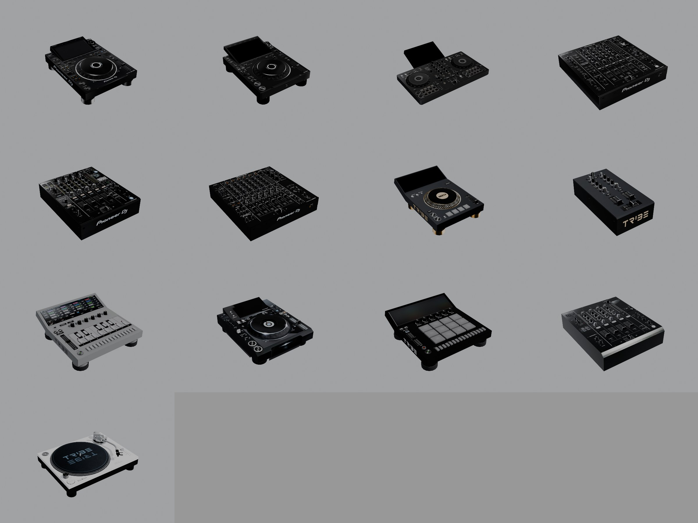

# Tribe XR gear: the 3D models

Every deck, mixer and instrument in Tribe XR 0.12.5.1 (build 2304), exported from the game's own cooked files to glTF
and PNG on 2026-10-26. The controls on each model, where they sit and what they do are in `deck_catalog.md`.

Row by row: CDJ-3000, CDJ-3000X, DDJ-FLX4, DJM-A9; DJM-900NXS2, DJM-V10, Starter CDJ, Starter Mixer; Tribe acid synth,
Tribe CDJ, Tribe drum machine, Tribe Mixer; Tribe vinyl deck. Three-quarter views from the front left. Each one also
has a top view (`*_top.png`, orthographic) in `D:/TribeUE/tribe_models/previews/`.

## The models

Each piece of gear is one skinned mesh, `Equipment/Models/SkeletalMeshes/SK_<model>`. Its bones are the moving parts
(faders, knobs, jog wheels); the catalog's bone positions come from these skeletons. Sizes are the mesh's bounds in
the export (width x depth x height).

| Model | Mesh | Size (cm) | On the model |
|---|---|---|---|
| CDJ-3000 | SK_CDJ3000 | 32.9 x 45.1 x 11.7 | Pioneer DJ logo |
| CDJ-3000X | SK_CDJ3000X | 32.8 x 46.5 x 12.3 | |
| DDJ-FLX4 (both decks and the mixer) | SK_DDJ-FLX4 | 72.9 x 63.3 x 13.3 | two decks, centre mixer, tablet stand |
| DJM-A9 | SK_DJM-A9 | 43.7 x 45.1 x 10.4 | Pioneer DJ logo |
| DJM-900NXS2 | SK_DJM-NXS-2 | 33.2 x 39.5 x 10.4 | Pioneer DJ logo |
| DJM-V10 | SK_DJM-V10 | 43.7 x 45.1 x 10.7 | Pioneer DJ logo |
| Starter CDJ | SK_StarterCDJ | 32.9 x 49.0 x 13.7 | Tribe logo, gold platter and feet, four pads |
| Starter Mixer | SK_StarterMixer | 18.0 x 34.0 x 10.4 | Tribe logo, two channels |
| Tribe CDJ | SK_TribeCDJ | 32.0 x 40.6 x 10.6 | a photo texture of a Pioneer CDJ-2000 (the side reads CDJ-2000) |
| Tribe Mixer | SK_TribeMixer | 33.1 x 38.2 x 9.7 | four channels |
| Tribe vinyl deck | SK_TribeVinylDeck | 45.2 x 35.2 x 13.4 | white turntable, Tribe slipmat |
| Tribe acid synth | SK_TribeAcidSynth | 39.3 x 42.4 x 13.3 | silver, screen and step keys, Tribe logo |
| Tribe drum machine | SK_TribeDrumMachine | 39.3 x 42.4 x 13.3 | 16 pads, Tribe logo |

## How a model is textured

Read from the Tribe CDJ's material (`MI_EqupimentTribeCDJ`, its JSON is next to its textures):

- `TextureA` is the gear with every control off; `TextureB` is the same layout lit (waveform on the screen, CDJ mode
  lit, master tempo LED on). Each sheet holds the top plate, the sides, and an atlas of the individual controls.
- `Segments` is a black-and-white mask of each control's region; the shader brings in `TextureB` where a control is
  active. That is what a control-info row's `ElementIndex` points into (`deck_catalog.md`).
- `Weights` (`T_TestPalette`), roughness 0.8, emissive strength 35, `TintBrightnessThreshold` 0.495.

The previews use `TextureA` only, so every control shows its "off" state.

## The files

Everything is under `D:/TribeUE/tribe_models/` (589 MB, kept out of the repo because it is Tribe's own art), in the
game's folder layout (`TribeXR/Content/Equipment/...`):

- 157 glTF meshes (`.glb`): the 13 gear bodies, with their materials' textures; and 144 control and part meshes (the
  knob, button and fader meshes under `Assets/Deck/<model>` and `Assets/Mixer/<model>`, the vinyl deck's and acid
  synth's parts, the APC40's), exported without textures because they share their model's atlases.
- 221 textures (`.png`), including the 24 deck skins under `Visuals/Skins/Rig`. Each skin is one replacement texture
  per piece of gear plus a menu preview: 15 for the Tribe CDJ and Tribe Mixer (Camo, Dash, Desty, Gold, Graffiti,
  Grunge, Hexatron, Illuminatty, Matrix, Night, Rainbow, Sandvich, Solaris, Symbols, White), 4 for the Starter CDJ and
  Starter Mixer (Iridescent, Starry, Symbols, WhitePaint) and 5 colours for the vinyl deck (its `TextureA`).
- 44 material files (`.json`): which texture goes in which slot, and the scalar parameters.

One texture didn't decode: `PF_ETC2_R11_EAC` isn't supported by this CUE4Parse.

## How it was made

1. `repak unpack` the Equipment and Visuals/Skins/Rig folders of `pakchunk0` (see `NOTES.md`).
2. CUE4Parse 1.2.2 for .NET 8 reads `.usmap` files up to version 3, so `uasset_tool downgrade
   pulled/TribeXR_full.usmap pulled/TribeXR_full_v3.usmap` writes one (each enum's names placed at their values; 10
   bit-flag enums keep their order).
3. `scripts/mesh_export` (CUE4Parse + CUE4Parse-Conversion 1.2.1) exports from the loose files:
   `mesh_export D:/TribeUE/tribe_assets/all/TribeXR pulled/TribeXR_full_v3.usmap D:/TribeUE/tribe_models --meshes
   --materials TribeXR/Content/Equipment/Models/SkeletalMeshes/`, then `--meshes --no-materials
   TribeXR/Content/Equipment/ --textures TribeXR/Content/Equipment/ TribeXR/Content/Visuals/Skins/Rig/`.
   Exporting every control mesh with its materials re-decodes the same 2048 x 4096 atlases each time; this order
   takes about 7 minutes instead of over an hour.
4. `scripts/render_gear.py` renders the previews in Blender 4.5 (Eevee, under the GPU lock):
   `blender -b --factory-startup --python scripts/render_gear.py -- D:/TribeUE/tribe_models D:/TribeUE/tribe_models/previews`.
   `--sheet-only` re-composes the contact sheet without rendering.
